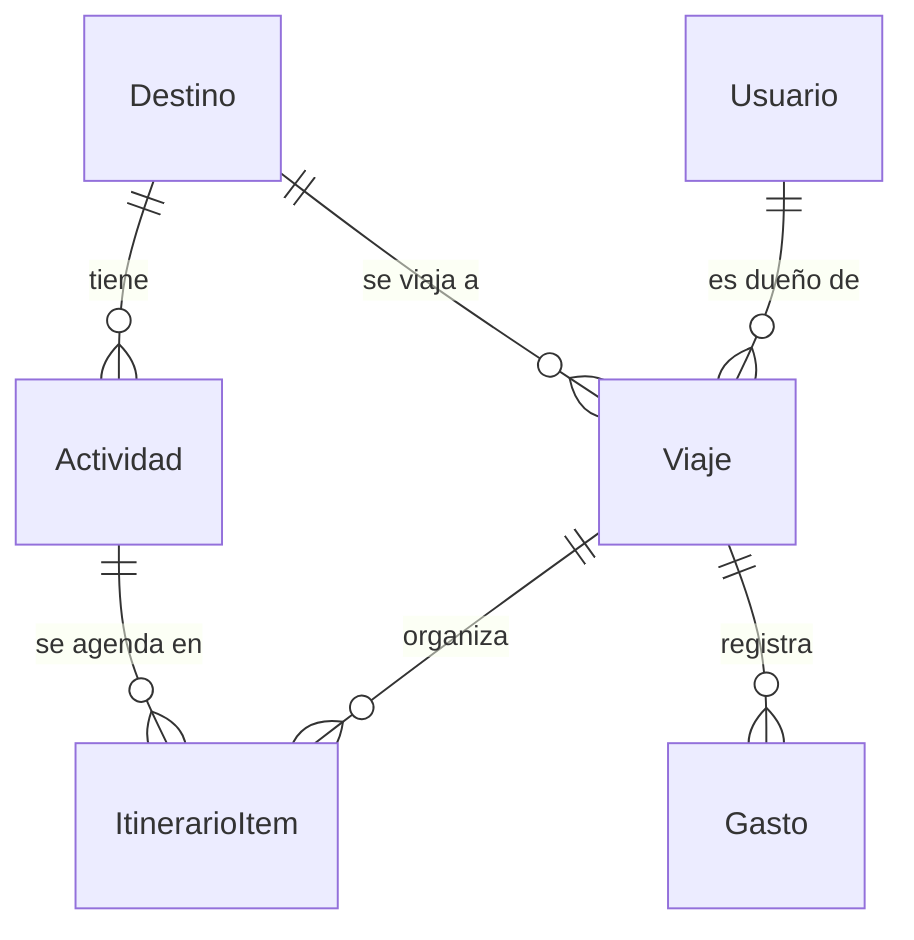

# Modelo de datos

## Entidades
| Entidad | Para qué sirve | Campos clave |
|---|---|---|
| Usuario | Cuenta de la persona | email único, hash de contraseña, rol (VIAJERO o ADMIN) |
| Destino | Ciudad a la que se viaja | nombre, coordenadas (para el pronóstico), zona horaria |
| Viaje | Viaje planificado de un usuario | fechas, presupuesto, moneda |
| Actividad | Lugar o actividad del catálogo | tipo (interior, exterior o mixta), fuente, fecha de relevamiento, activa |
| ItinerarioItem | Pone una actividad en un día de un viaje | fecha, orden, nota |
| Gasto | Fila de la bitácora de gastos | categoría, fase, monto estimado, monto real (vacío hasta que ocurre) |

## Decisiones del esquema (para poder defenderlas)
- **IDs UUID:** no se pueden adivinar ni recorrer en la URL. No reemplaza la verificación de dueño, que se hace igual en cada pedido.
- **Dinero en `Decimal(12,2)`:** los decimales binarios (float) acumulan errores de redondeo y los totales dejarían de cerrar.
- **`Destino` como tabla:** hoy hay una sola fila (Ciudad de Buenos Aires). Sumar otra ciudad es cargar datos, no cambiar código.
- **Actividades archivables:** `ItinerarioItem → Actividad` es `Restrict`. Si el admin "borra" una actividad que está en itinerarios, se archiva (`activa = false`) y los viajes siguen intactos.
- **Importación sin duplicados:** `fuente + fuenteId` es único, así que reimportar el catálogo no repite lugares. `relevadoEn` guarda la fecha del dato original para mostrarla.
- **Borrado en cascada:** al borrar un viaje se borran su itinerario y sus gastos. Al borrar un usuario, sus viajes.
- **`moneda` en el viaje:** hoy siempre ARS. Dejarla preparada permite sumar otras monedas con una migración chica.
- **Fuera del esquema a propósito:** notas de bitácora por día, reseñas, paquetes y agencias. Se agregan como tablas nuevas sin tocar las existentes.
